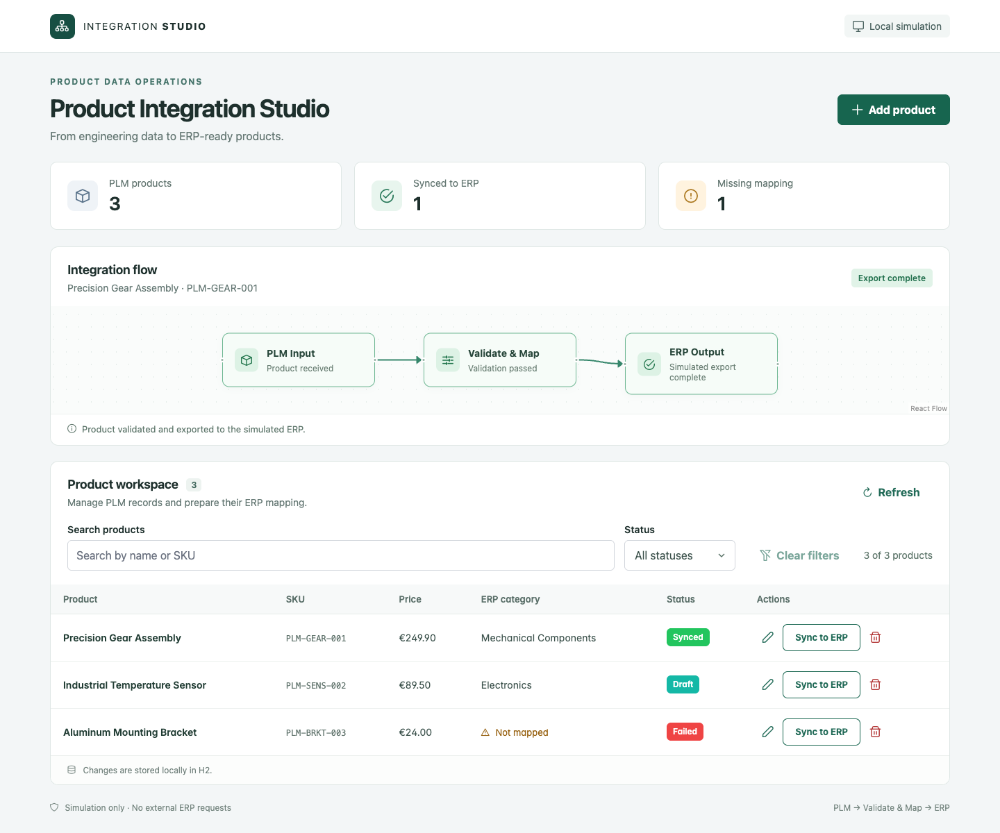
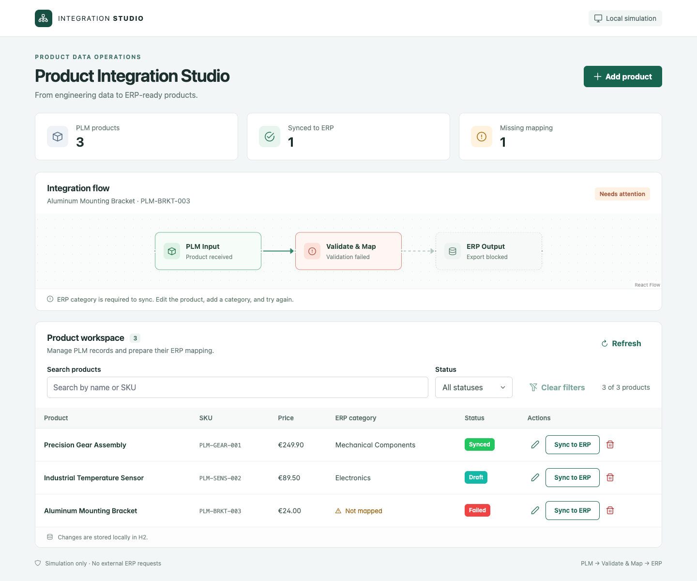
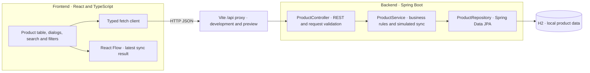

# Product Integration Studio

A local full-stack application for managing product data and demonstrating a **PLM-to-ERP integration scenario**. An operator creates or edits a product, checks its ERP category, and follows a simulated synchronization result in a three-stage diagram.

**Implemented:** product CRUD, validation, persistent storage, search/filtering, and interactive status visualization. **Simulated:** the PLM source and ERP destination. No SAP, Microsoft Dynamics, or external company system is contacted, and no ERP export is sent.

[Quick start](#quick-start) · [Architecture](#architecture) · [REST API](#rest-api) · [Tests](#tests-and-builds) · [Two-minute demo](#two-minute-demo)

## Application preview

Captured from the running production frontend and Spring Boot backend using the project's synthetic demo products. The successful sync updates both the table and React Flow:



<details>
<summary>View the missing-category validation failure</summary>

The backend saves `FAILED`; the diagram displays the validation error and blocks the simulated export.



</details>

## What you can do

| Capability | Implemented behavior |
| --- | --- |
| Create | Add a product with a unique SKU, name, and nonnegative price. ERP category is optional until sync. New products start as `DRAFT`. |
| Read | Load products from the REST API; view price, category, and status in a PrimeReact table. Refresh reloads the list. |
| Update | Edit product fields in a dialog. Every successful save resets the product to `DRAFT`, requiring another sync. |
| Delete | Confirm the product name and SKU before permanent local deletion. Cancel sends no request; failures keep the row and allow retry. Success updates counts and clears the deleted product's flow result. |
| Search | Match a substring in **name OR SKU**, ignoring case and surrounding search whitespace. Characters such as `%` and `_` are literal. |
| Filter | Select All statuses, Draft, Synced, or Failed. The status condition combines with search using **AND**. Clear filters restores all loaded products. |
| Sync | Validate the stored product, persist `SYNCED` or `FAILED`, and visualize the result. No external export occurs. |

Search and filtering run in the browser on the full loaded list. The result counter shows matching/total products; overview cards describe the full dataset. Create, edit, delete, and sync automatically reapply active filters. The **Refresh** button retains filters; a browser reload resets them. Empty database and no-match results have distinct messages.

## Quick start

Prerequisites: **Java 21**, **Node.js 22.12+**, npm, and Git. The checked-in Maven Wrapper downloads Maven 3.9.11; no global Maven installation is required. Initial dependency installation needs internet access.

```sh
git clone https://github.com/CuZn6666/Product-Integration-Studio.git
cd Product-Integration-Studio
```

**Terminal 1 — backend**, from the repository root:

```sh
cd Backend
./mvnw spring-boot:run
```

**Terminal 2 — frontend**, from the repository root:

```sh
cd Front
npm ci
npm run dev
```

- Application: **http://127.0.0.1:5173/**
- REST API: **http://127.0.0.1:8080/api/products**
- Stop each service with `Ctrl+C`.

Both services bind to loopback. Vite proxies `/api` to the backend, so local development needs no separate CORS configuration. On macOS, `Backend/mvnw` selects an installed JDK 21 automatically. On Linux, set `JAVA_HOME` to your JDK 21 installation. These launch instructions target macOS/Linux shells.

Run backend commands inside `Backend/`: the H2 path is relative to the working directory. Records and statuses persist in `Backend/data/products.mv.db`, which is excluded from Git. A new database starts with three synthetic products: a gear assembly, a temperature sensor, and a bracket without an ERP category. A persistent initialization marker prevents reseeding after deletion, even after deleting every product. Existing nonempty databases are preserved.

## Architecture



Responses return through the same HTTP path and update React state. The flow diagram is a view of the latest request outcome, not a separate service or workflow engine. There is deliberately no external ERP node in the application architecture.

**Design choices:** explicit request/response DTOs keep the API contract separate from JPA entities; a transactional service owns status changes; `BigDecimal` stores decimal prices. Component state and client-side filtering keep the small demo simple. H2 provides local persistence without a database server. These choices favor an easy local demonstration over large datasets or production operations.

### Technology roles

| Technology | Role in this application | Source entry point |
| --- | --- | --- |
| Java 21 | Domain model, records for DTOs, enums for statuses, decimal prices | [Product.java](Backend/src/main/java/com/innoface/studio/Product.java) |
| Spring Boot 3.5 / Spring Web | Application startup, dependency injection, REST endpoints, JSON responses | [ProductController.java](Backend/src/main/java/com/innoface/studio/ProductController.java) |
| Jakarta Validation | Required fields, string lengths, and price constraints; revalidated on sync | [ProductRequest.java](Backend/src/main/java/com/innoface/studio/ProductRequest.java) |
| Spring Data JPA / Hibernate | Entity persistence, unique SKU constraint, repository queries, transactions | [ProductRepository.java](Backend/src/main/java/com/innoface/studio/ProductRepository.java), [ProductService.java](Backend/src/main/java/com/innoface/studio/ProductService.java) |
| H2 | File database for local use; isolated in-memory database for backend tests | [application.properties](Backend/src/main/resources/application.properties) |
| React 18 / TypeScript 5.9 | Controlled forms, component state, typed API client, derived search results | [App.tsx](Front/src/App.tsx), [api.ts](Front/src/api.ts) |
| PrimeReact 10 / PrimeIcons | Product table, dialogs, buttons, inputs, status tags, and icons | [ProductDialog.tsx](Front/src/ProductDialog.tsx) |
| React Flow 12 (`@xyflow/react`) | Three connected stages reflecting sync progress, success, or failure | [IntegrationFlow.tsx](Front/src/IntegrationFlow.tsx) |
| HTML / CSS | Semantic page structure, responsive layout, and status styling | [styles.css](Front/src/styles.css), [index.html](Front/index.html) |
| Vite 6 / npm | Local server, API proxy, frontend build, and dependency scripts/lockfile | [vite.config.ts](Front/vite.config.ts), [package.json](Front/package.json) |
| Maven Wrapper | Reproducible backend build, dependency resolution, Java 21 enforcement | [pom.xml](Backend/pom.xml), [mvnw](Backend/mvnw) |
| JUnit / Spring Boot Test / MockMvc | Backend integration tests through the HTTP controller layer | [ProductApiTest.java](Backend/src/test/java/com/innoface/studio/ProductApiTest.java) |
| Vitest / Testing Library / jsdom | Filter, API-client, and React interaction tests | [Front/tests/](Front/tests/) |
| Git | Version history for source and documentation; generated/local data excluded | [.gitignore](.gitignore) |

### Repository map and review path

```text
Product-Integration-Studio/
├── Front/
│   ├── src/                 # React components, typed API client, filters, CSS
│   ├── tests/               # Component, API-client, and filter tests
│   ├── package.json
│   ├── package-lock.json
│   └── vite.config.ts
├── Backend/
│   ├── src/main/java/com/innoface/studio/  # Controller, service, DTOs, entities, repositories
│   ├── src/main/resources/  # Local application configuration
│   ├── src/test/java/       # API integration tests
│   ├── .mvn/                # Maven Wrapper configuration
│   ├── mvnw
│   ├── mvnw.cmd
│   └── pom.xml
├── docs/screenshots/        # Genuine application captures
├── AGENTS.md
├── WORKPACKAGE.md
├── TOKEN_EFFICIENCY.md
└── README.md
```

For a quick code review, follow [ProductController](Backend/src/main/java/com/innoface/studio/ProductController.java) → [ProductService](Backend/src/main/java/com/innoface/studio/ProductService.java) → [Product](Backend/src/main/java/com/innoface/studio/Product.java), then [api.ts](Front/src/api.ts) → [App.tsx](Front/src/App.tsx). Read [productFilters.ts](Front/src/productFilters.ts) and [DeleteProductDialog.tsx](Front/src/DeleteProductDialog.tsx) for the search and deletion behavior. The tests above show expected success and failure cases.

## REST API

All endpoints use the `/api/products` prefix. This is the complete implemented endpoint list; there is no single-product GET endpoint or server-side search endpoint.

| Method | Endpoint | Response |
| --- | --- | --- |
| GET | `/api/products` | `200`: all products ordered by ID |
| POST | `/api/products` | `201`: saved product with generated ID and Location header |
| PUT | `/api/products/{id}` | `200`: saved product, reset to `DRAFT` |
| DELETE | `/api/products/{id}` | `204`: empty body; `404` if missing or already deleted |
| POST | `/api/products/{id}/sync` | `200`: simulated success or business-validation failure |

Create/update body:

```json
{
  "name": "Drive Module",
  "sku": "DEMO-DRIVE-001",
  "price": 129.95,
  "erpCategory": "Drive Systems"
}
```

Responses add `id` and `status`. Name and SKU are required and trimmed, with maximum lengths of 120 and 64 characters. SKU uniqueness is case-sensitive. Price is required, nonnegative, and supports up to 12 integer digits and two decimal places. Category is optional when saving and limited to 80 characters. The UI displays prices in EUR.

Invalid save requests or malformed IDs return `400`; duplicate SKUs return `409`; unknown IDs return `404`. Errors contain `message` and `fieldErrors`; unexpected server errors return `500`. Quick read-only check:

```sh
curl http://127.0.0.1:8080/api/products
```

## Simulated ERP synchronization

1. Create or edit a product: the backend saves it as `DRAFT`.
2. Click **Sync to ERP**: the UI calls `POST /api/products/{id}/sync`.
3. The service revalidates stored fields and requires a nonblank ERP category.
4. Valid data becomes `SYNCED`; invalid data becomes `FAILED`. The status is persisted in H2.
5. The UI updates the product row and `PLM Input → Validate & Map → ERP Output` diagram.

```json
{
  "productId": 1,
  "outcome": "SUCCESS",
  "message": "Product validated and exported to the simulated ERP.",
  "status": "SYNCED"
}
```

A missing category returns HTTP `200` with `outcome: "FAILURE"`, `status: "FAILED"`, and an actionable message. This distinguishes a completed business validation from a failed HTTP request. Correcting and saving the product resets it to `DRAFT`; syncing again can succeed. A network error leaves the outcome unconfirmed.

Example business-validation failure:

```json
{
  "productId": 3,
  "outcome": "FAILURE",
  "message": "ERP category is required to sync. Edit the product, add a category, and try again.",
  "status": "FAILED"
}
```

**Simulation boundary:** the category is a validation rule, not a lookup against real ERP master data. “Validate & Map” does not produce an ERP-specific payload. The diagram summarizes the single request result; stages are not streamed from a real integration pipeline. Product persistence and status changes are real local operations.

## Tests and builds

From the repository root, with frontend dependencies installed as in Quick start:

```sh
cd Backend
./mvnw test
./mvnw -DskipTests package
cd ../Front
npm test
npm run build
```

Verified on **22 November 2026**: **13 backend tests**, **17 frontend tests**, Maven packaging, and the TypeScript/Vite production build passed. The package command skips rerunning tests only after the explicit test command succeeds.

- Backend tests use isolated in-memory H2 and cover CRUD, validation, unique SKUs, sync outcomes, and initialization behavior.
- Frontend tests cover combined filtering, API errors/empty responses, and create/edit/sync/delete interactions. React Flow is mocked in application tests; these tests do not establish canvas rendering.
- The screenshots above were captured separately in Chrome against the real backend and production frontend, including successful sync, missing-category failure, three nodes, and two edges.

For an offline local demo, complete dependency installation and builds first. In a new terminal at the repository root, select Java 21 and run:

```sh
cd Backend
# macOS only; on Linux, use your installed JDK 21 path instead:
export JAVA_HOME=$(/usr/libexec/java_home -v 21)
"$JAVA_HOME/bin/java" -jar target/product-integration-studio-0.0.1-SNAPSHOT.jar
```

In another terminal at the repository root:

```sh
cd Front
npm run preview -- --port 5173 --strictPort
```

Open http://127.0.0.1:5173/. Preview proxies `/api` to port 8080; it is for local evaluation, not a production hosting setup. Keep the generated JAR, frontend `dist/`, and installed frontend dependencies on the demo machine. No external service is needed during the demo. `STUDIO_API_TARGET` can override the Vite development/preview proxy target for isolated local checks.

## Two-minute demo

Start both services beforehand. Keep a product without an ERP category available and choose a new SKU for each run.

| Time | Action | What to explain |
| --- | --- | --- |
| 0–15 s | Show the table and simulation label. | “This application manages product data and simulates a PLM-to-ERP workflow.” |
| 15–40 s | Add a product with name, unique SKU, price, and category. | “React calls a typed REST client. Spring validates the request and saves it in H2.” |
| 40–60 s | Sync the new product and show the green flow. | “The backend persists the result; React Flow visualizes it. No external ERP is contacted.” |
| 60–85 s | Sync an unmapped product, then open Edit and add a category. | “Missing mapping is a readable business failure. Saving the correction resets the product to Draft.” |
| 85–105 s | Search by SKU and combine it with a status filter, then clear filters. | “Search matches name or SKU and combines with status. Filtering is local to this small dataset.” |
| 105–120 s | Open Delete for the demo product, cancel, then refresh. | “Deletion requires confirmation. Saved records and statuses persist; the diagram shows only the latest sync.” |

## Scope and limitations

This is a local, single-operator prototype. It has no authentication/authorization, audit history, conflict resolution, undo/soft deletion, server-side search, or pagination. The fixed React Flow diagram is not an editable workflow engine. The latest flow message and filters clear on page reload; saved products and statuses persist.

There is **no real PLM/ERP connection, SAP integration, AWS deployment, or production hosting configuration**. Linux instructions describe local execution, not a completed deployment. Dependencies, build output, local databases, environment files, and editor settings are excluded from Git.

Implementation milestones and verification notes are in [WORKPACKAGE.md](WORKPACKAGE.md). The project was developed with AI assistance; its small scope is intended to make the implementation straightforward to inspect, run, and explain.
